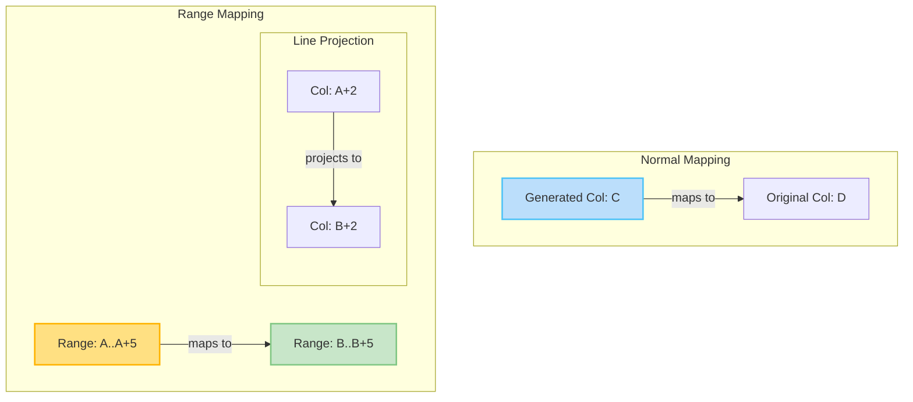
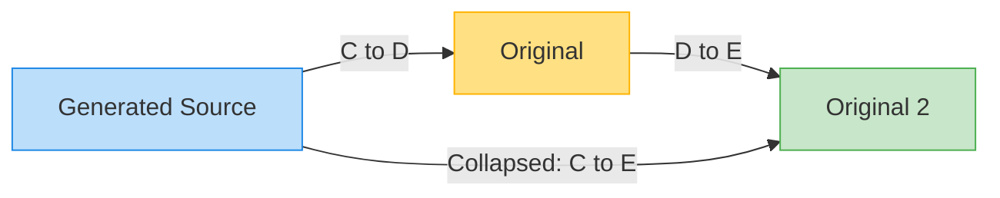
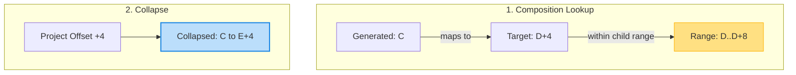
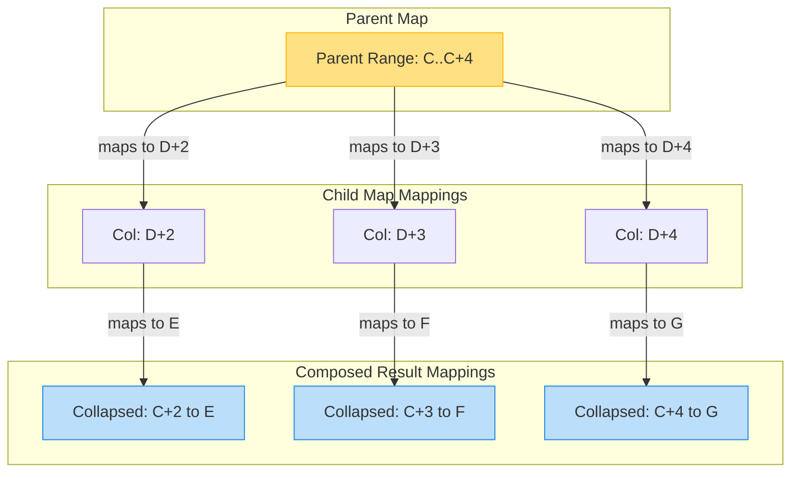
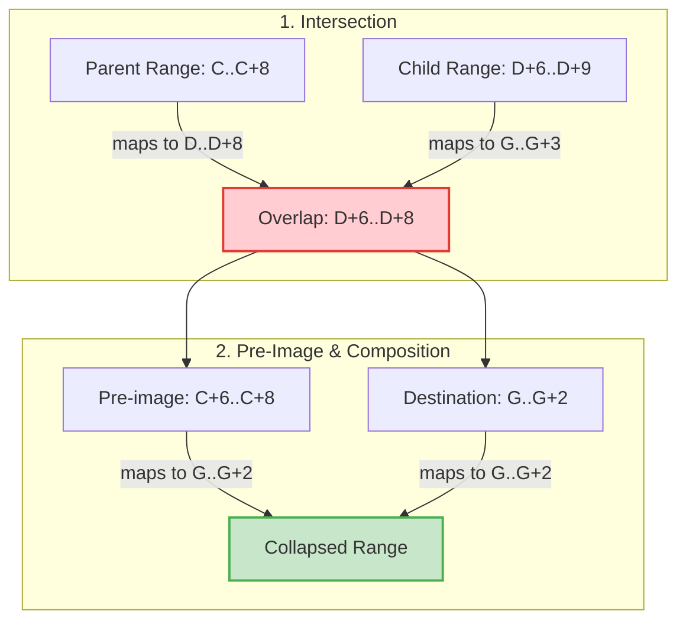
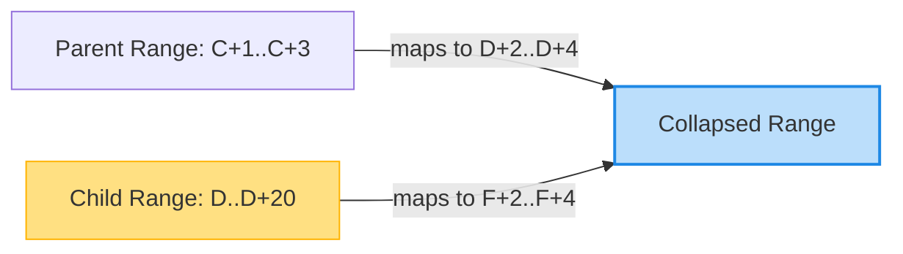
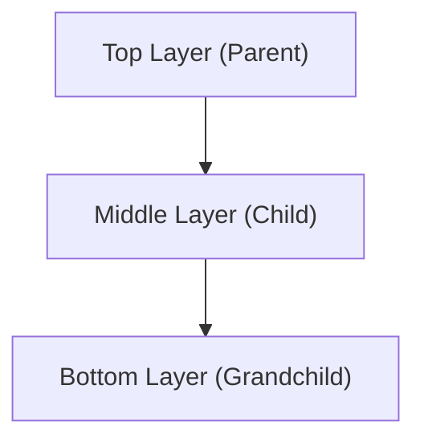

# Understanding Source Map Range Mappings & Composition Scenarios

This document provides a complete explanation of **Source Map Range Mappings** and their **Composition Algorithms**, based on the technical proposal and presentation.

To make these concepts easy to follow, we use consistent terminology:
*   **Parent Map (Root/Top Layer)**: The sourcemap closer to the final generated file.
*   **Child Map (Bottom/Child Layer)**: The sourcemap closer to the original source files.
*   **Ranges**: An interval mapping of the form `[Start, End]` rather than a single point mapping.
*   **Composition (or Remapping)**: The process of collapsing multiple layers of sourcemaps into a single direct map from the final generated code back to the original sources.

---

## Concept Overview: Normal vs. Range Mappings

Traditionally, sourcemaps map a single point (line/column) in generated code to a single point in original code.
*   **Normal Mapping (Point-to-Point)**: `C -> D` maps column `C` to column `D`.
*   **Range Mapping (Interval-to-Interval)**: `[A, A+N] -> [B, B+N]` maps a contiguous range of columns starting at `A` (width `N`) to a contiguous range starting at `B` (same width `N`). Any point within the parent range projects linearly onto the child range with the exact same relative offset.

---

## Scenario 1: Normal Mapping composed with Normal Mapping

The simplest form of remapping: both the Parent and Child maps use point-to-point normal mappings.

### Diagram

### Step-by-Step Execution:
1.  **Parent Map**: Contains the mapping `C -> D`.
2.  **Child Map**: Contains three independent child mappings starting at the intermediate source:
    *   `D -> E`
    *   `F -> G`
    *   `H -> I`
3.  **Composition Lookup**: 
    *   Take the parent mapping's target column `D`.
    *   Query the child map for a mapping starting at column `D`.
    *   We find `D -> E`.
4.  **Collapse**: Combining `C -> D` and `D -> E` yields the direct composed mapping: **`C -> E`**.

> [!NOTE]
> **Output Type**: **Normal Mapping (Point-to-Point)**.
> Composing a point mapping with another point mapping always yields a point mapping.

---

## Scenario 2: Normal Mapping composed with Child Range Mapping

The Parent map has a single point-to-point normal mapping, but the Child map contains a range mapping.

### Diagram

### Step-by-Step Execution:
1.  **Parent Map**: Maps generated column `C` to target column `D + 4` (i.e., normal mapping **`C -> D + 4`**).
2.  **Child Map**: Contains a child range mapping **`[D, D+8] -> [E, E+8]`** alongside normal mappings `F -> G` and `H -> I`.
3.  **Composition Lookup**:
    *   Target column is `D + 4`.
    *   Search the child map. The target `D + 4` falls inside the child's range mapping `[D, D+8]`.
4.  **Collapse**:
    *   Calculate the relative offset: `(D + 4) - D = +4`.
    *   Apply this offset to the child range's destination start column `E`.
    *   Resulting target is `E + 4`.
    *   Composed point mapping: **`C -> E + 4`**.

> [!NOTE]
> **Output Type**: **Normal Mapping (Point-to-Point)**.
> Even though the intermediate target fell within a child range mapping, because the parent mapping was a single point, the resulting composed mapping is resolved to a single point.

---

## Scenario 3: Multiple Child Mappings inside a Parent Range Mapping

The Parent map defines a broad range mapping, and the Child map contains several point-to-point mappings that fall *within* that range.

### Diagram

### Step-by-Step Execution:
1.  **Parent Map**: Contains a range mapping **`[C, C+4] -> [D, D+4]`**.
2.  **Child Map**: Contains three distinct point mappings within the parent's target interval `[D, D+4]`:
    *   `D + 2 -> E` (maps to child source *Original 2*)
    *   `D + 3 -> F` (maps to child source *Original 2*)
    *   `D + 4 -> G` (maps to child source *Original 3*)
3.  **Composition Lookup**:
    *   The parent range defines a continuous mapping zone.
    *   Identify all child mappings whose input columns fall within the parent's output interval `[D, D+4]`. All three child mappings qualify.
4.  **Collapse (Pre-Image Projection)**:
    *   For `D + 2 -> E`: Offset is `+2`. Projects back to generated column `C + 2`. Result: **`C + 2 -> E`**.
    *   For `D + 3 -> F`: Offset is `+3`. Projects back to generated column `C + 3`. Result: **`C + 3 -> F`**.
    *   For `D + 4 -> G`: Offset is `+4`. Projects back to generated column `C + 4`. Result: **`C + 4 -> G`**.
5.  **Final Composed Map**: The broad parent range maps directly to three discrete child point mappings.

> [!NOTE]
> **Output Type**: **Multiple Normal Mappings (Point-to-Point)**.
> When discrete point mappings fall inside a broad parent range mapping, they "shatter" the parent range mapping, transforming the output into individual, discrete point mappings.

---

## Scenario 4: Range Mappings in Both Parent & Child (Intersection)

When range mappings overlap in both the Parent and Child maps, the composed mapping is determined by their **intersection**.

### Sub-Scenario A: Simple Intersection & Truncation

#### Diagram

#### Step-by-Step Execution:
1.  **Parent Map**: Range mapping **`[C, C+8] -> [D, D+8]`**.
2.  **Child Map**: Range mapping **`[D+6, D+9] -> [G, G+3]`**.
3.  **Calculate Intersection**:
    *   The parent maps into `[D, D+8]`.
    *   The child maps out of `[D+6, D+9]`.
    *   Overlap/Intersection interval: **`[D+6, D+8]`**. (Notice the child's range is truncated from width 3 to width 2).
4.  **Project to Parent (Pre-Image)**:
    *   `[D+6, D+8]` has offsets `[+6, +8]` relative to the parent's start column `D`.
    *   Projects back to generated columns: **`[C+6, C+8]`**.
5.  **Project to Child (Destination)**:
    *   `[D+6, D+8]` has offsets `[+0, +2]` relative to the child's start column `D+6`.
    *   Projects forward to original source columns: **`[G, G+2]`**.
6.  **Final Composed Range**: **`[C+6, C+8] -> [G, G+2]`**.

> [!NOTE]
> **Output Type**: **Range Mapping (Interval-to-Interval)**.
> Composing a range mapping with another overlapping range mapping results in a new range mapping (representing their shared overlap).

### Sub-Scenario B: Child Range is Larger than Parent Range

#### Diagram

#### Step-by-Step Execution:
1.  **Parent Map**: Contains two small range mappings:
    *   `[C+1, C+3] -> [D+2, D+4]` (width 2)
    *   `[C+6, C+9] -> [D+13, D+16]` (width 3)
2.  **Child Map**: Contains one giant range mapping:
    *   `[D, D+20] -> [F, F+20]` (width 20)
3.  **Composition**:
    *   **Range 1**: `[D+2, D+4] ∩ [D, D+20] = [D+2, D+4]`.
        *   Pre-image on Parent: `[C+1, C+3]`.
        *   Offset relative to Child start `D` is `+2` to `+4`.
        *   Destination: `[F+2, F+4]`.
        *   Result: **`[C+1, C+3] -> [F+2, F+4]`**.
    *   **Range 2**: `[D+13, D+16] ∩ [D, D+20] = [D+13, D+16]`.
        *   Pre-image on Parent: `[C+6, C+9]`.
        *   Offset relative to Child start `D` is `+13` to `+16`.
        *   Destination: `[F+13, F+16]`.
        *   Result: **`[C+6, C+9] -> [F+13, F+16]`**.

> [!NOTE]
> **Output Type**: **Multiple Range Mappings**.
> Since both parent range mappings fall entirely within the single larger child range, they are both preserved as independent range mappings.

---

## Scenario 5: Multi-Layer Composition (> 2 Layers of Sourcemaps)

When remapping across three or more layers (e.g., Top/Root Level, Middle Level, and Bottom Level), we have two options for executing the recursion steps. Mathematically, **remapping is associative**—both approaches yield the exact same result.

### Option A: Top-Down (Collapse Top/Middle first)

1.  **Step 1**: Compose the **Top Layer** (`[C, C+8] -> [D, D+8]`) and the **Middle Layer** (`[D+2, D+4] -> [F, F+2]` and `D+7 -> G`).
    *   This collapses the first two layers into a composed middle layer:
        *   `[C+2, C+4] -> [F, F+2]` (**Range Mapping**, from intersection)
        *   `C+7 -> G` (**Normal Mapping**, from point mapping inside range)
2.  **Step 2**: Compose this newly collapsed layer with the **Bottom Layer** (`F -> J`, `F+1 -> K`).
    *   `F -> J` falls inside `[F, F+2]` at offset `+0`. Pre-image: `C+2`. Result: **`C+2 -> J`**.
    *   `F+1 -> K` falls inside `[F, F+2]` at offset `+1`. Pre-image: `C+3`. Result: **`C+3 -> K`**.

> [!NOTE]
> **Output Type**: **Multiple Normal Mappings** (`C+2 -> J` and `C+3 -> K`).
> In Step 1, composing two range mappings yields a range mapping. In Step 2, composing that range mapping with discrete child point mappings shatters it into normal point-to-point mappings.

### Option B: Bottom-Up (Collapse Middle/Bottom first)

1.  **Step 1**: Compose the **Middle Layer** and the **Bottom Layer** first.
    *   The middle range `[D+2, D+4] -> [F, F+2]` composed with bottom points `F -> J` and `F+1 -> K` collapses into:
        *   `D+2 -> J` (**Normal Mapping**, offset `+0` inside range)
        *   `D+3 -> K` (**Normal Mapping**, offset `+1` inside range)
2.  **Step 2**: Compose the **Top Layer** (`[C, C+8] -> [D, D+8]`) with this newly collapsed bottom layer.
    *   Point `D+2 -> J` falls inside parent range `[D, D+8]` at offset `+2`. Pre-image: **`C+2 -> J`**.
    *   Point `D+3 -> K` falls inside parent range `[D, D+8]` at offset `+3`. Pre-image: **`C+3 -> K`**.

> [!NOTE]
> **Output Type**: **Multiple Normal Mappings** (`C+2 -> J` and `C+3 -> K`).
> In Step 1, the range mapping in the middle is shattered by the bottom point mappings, resulting in point-to-point mappings. In Step 2, those point mappings project back through the top range mapping to yield point-to-point mappings. Both Options yield identical outputs!
